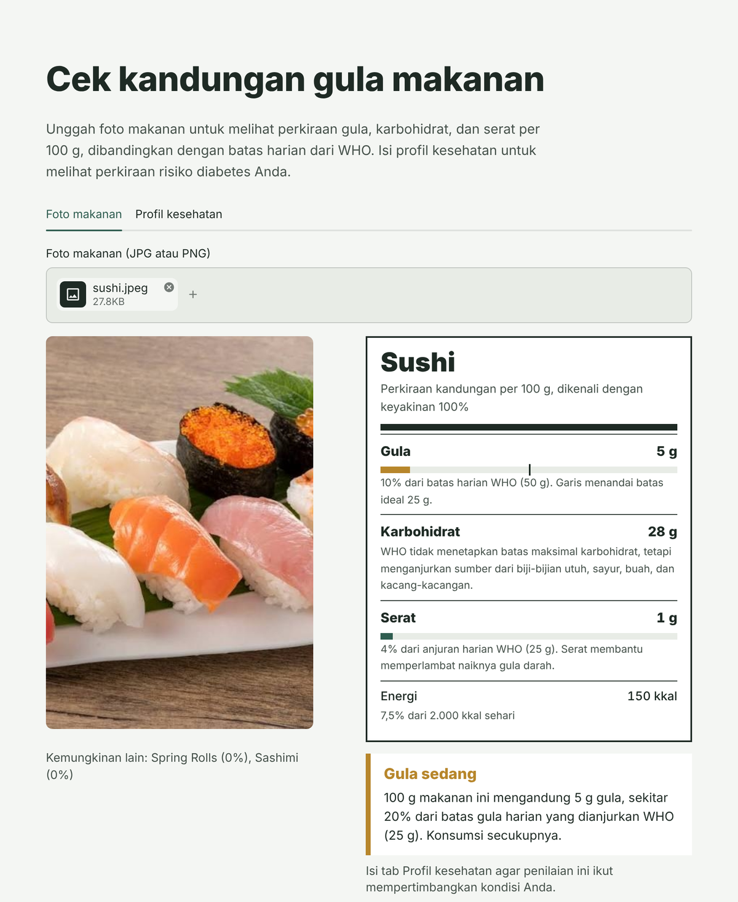
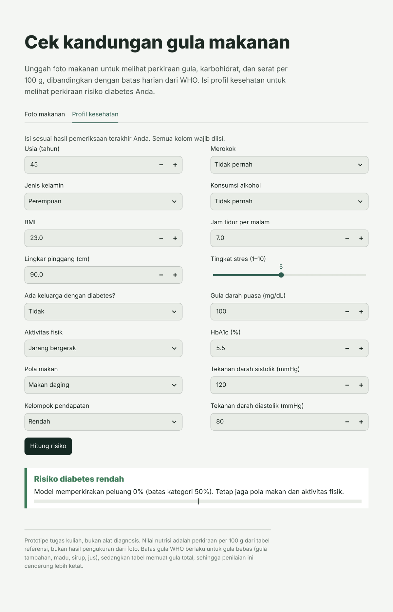

# Food & Diabetes Risk App

A Streamlit app that looks at a photo of food, recognises the dish, and shows its sugar, carbohydrate and fibre per 100 g compared with **WHO daily limits**. A second tab estimates diabetes risk from a health profile, and when that risk is high the food assessment adds a warning.

Built for the Deep Learning course at Universitas Multimedia Nusantara (2026) by a team of four, as the prototype for *Food Classification Based on Nutritions to Recognize Diabetes Risks*.

> Academic prototype, not a medical diagnosis tool.

<p align="center">
  
  
</p>

## How it works

| Step | What happens | Method | Built by |
| --- | --- | --- | --- |
| Photo → dish | Recognises 101 dishes | EfficientNetB0, transfer learning on Food-101 | Andy |
| Dish → nutrition | Sugar, carbs, fibre and energy per 100 g | Reference table | Felicia |
| Health profile → diabetes risk | Low or high risk with a probability | Deep learning (MLP) | Fabian |
| Nutrition → food rating | Low, medium or high sugar | Rules from WHO daily limits | **Alto Dev** |
| App and integration | Joins everything, input validation, tests | Streamlit, pytest | **Alto Dev** |

What is rated from the photo is the **food**, not a person's diabetes risk; one dish does not decide whether someone has diabetes.

## Sugar rating rules (`src/food_risk.py`)

WHO recommends keeping free sugars under 10% of daily energy (about 50 g for 2,000 kcal), ideally under 5% (about 25 g), and eating at least 25 g of fibre a day. The app grades sugar per 100 g against the ideal 25 g:

| Sugar per 100 g | Rating | Why |
| --- | --- | --- |
| ≥ 12.5 g | High | At least half the ideal daily limit |
| 5 – 12.5 g | Medium | 20–50% of the ideal daily limit |
| < 5 g | Low | Under 20% of the ideal daily limit |

WHO sets no maximum for carbohydrates, so they are shown without a rating. Sources: WHO, *Guideline: Sugars intake for adults and children* (2015); [WHO Healthy diet fact sheet](https://www.who.int/news-room/fact-sheets/detail/healthy-diet); [WHO 2023 carbohydrate guideline](https://www.who.int/news/item/17-07-2023-who-updates-guidelines-on-fats-and-carbohydrates).

## Engineering notes

- **Service modules with clear interfaces.** Each teammate's part sits behind its own module (`food_service`, `nutrition_service`, `diabetes_service`), so a new model or table can be dropped in without touching the UI.
- **Keras compatibility loader.** The food model was saved with a newer Keras version than Google Colab had, so it failed to load. `src/keras_compat.py` removes the config fields the older version does not recognise and loads the model with its trained weights unchanged.
- **Low-confidence handling.** Below 70% confidence, the app shows its top three guesses and asks the user to pick the right dish instead of trusting a wrong label.
- **Out-of-range warnings.** Health inputs far outside the training data are flagged.

## Tests

25 automated tests (`pytest`) cover diabetes input validation, out-of-range warnings, the nutrition table (missing file, wrong columns, empty values), the table matching all 101 model classes, the food model contract, Keras compatibility, and the WHO sugar thresholds, including the exact 5 g and 12.5 g boundaries.

## Run it

Python 3.11 or 3.12:

```bash
pip install -r requirements.txt
python -m pytest -q        # 25 passed
streamlit run app.py
```

Or open [`notebooks/run_in_colab.ipynb`](notebooks/run_in_colab.ipynb) in Google Colab; it installs the app, runs the tests and gives a public demo link.

## Project structure

```
app.py                      Streamlit UI (food photo tab + health profile tab)
src/food_service.py         loads the food model, returns the top 3 predictions
src/nutrition_service.py    looks up nutrition per 100 g
src/food_risk.py            WHO-based sugar rating rules
src/diabetes_service.py     loads the diabetes model and validates inputs
src/keras_compat.py         loads models saved with a newer Keras version
models/                     trained food and diabetes models
data/food_nutrition.csv     nutrition table for the 101 dishes
tests/test_services.py      automated tests
docs/README-id.md           original Indonesian README with manual test cases
```

## Known limits

- Nutrition values are estimates per dish, not per-item USDA measurements, and the table holds total sugar while WHO limits apply to free sugar, so ratings lean strict.
- The food model was trained on Food-101, so it can confuse similar dishes (for example, steak and prime rib) and does not know many Indonesian dishes.
- The diabetes risk model has not been clinically validated.
